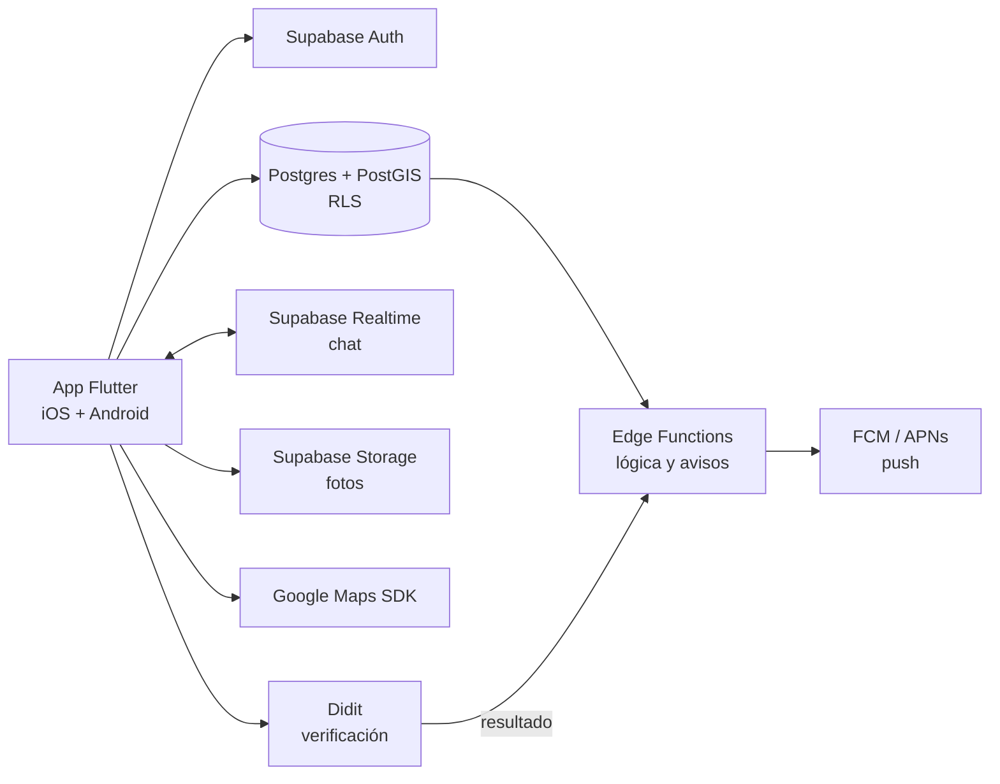

# Pacer Match: documento de visión

Versión 0.2 · 25 de octubre de 2026 · Incluye las respuestas del PO a la versión 0.1 · Autor: Moisés Escudero

## 1. En una línea
Pacer Match conecta corredores que buscan compañía para una sesión concreta (mismo ritmo, distancia, hora y zona), sin necesidad de pertenecer a un club, y lo hace de forma segura: identidad verificada y punto de encuentro protegido hasta que hay match. Empieza en Caracas. Proponemos un MVP con infraestructura de costo casi cero para mostrar tracción a inversionistas, construido sobre la misma base que usará el producto, para no tirarlo después.

## 2. Problema y oportunidad
- **Problema (spec del PO):** corredores que no encuentran compañeros de su mismo ritmo o distancia dentro de su club o zona.
- **La categoría existe, pero atada a clubes.** Strava reporta 195 millones de atletas y en julio de 2026 sumó una pestaña de eventos con carreras grupales, pero esos entrenamientos son para quien pertenece al club que los crea. Hay apps que emparejan por ritmo: Movemates, Run with me (ritmo verificado) y RunPal (opción solo mujeres).
- **Hueco a validar:** compañía para una sesión puntual, sin pertenecer a un club, con la identidad verificada como estándar. Primer mercado: Caracas.

## 3. Usuarios
| Perfil | Qué necesita | Qué le da Pacer Match |
|---|---|---|
| Corredor independiente (público principal) | Compañía de su ritmo para una sesión concreta, sin unirse a un club | Feed por radio, ritmo y fecha; solicitud con mensaje. Es quien paga la suscripción (sección 8). |
| Corredor de paso por la ciudad | Compañía para correr mientras está de visita | Lo mismo que el independiente, en la ciudad donde está |
| Corredor de club | Entrenar fuera del horario o del ritmo de su club | Sesiones puntuales con gente de su zona |
| Visitante | Ver si hay movimiento antes de registrarse | Feed restringido (zona y ritmo) |
| Club o entrenador (segunda etapa) | Llenar sesiones y gestionar grupo | Plan para clubes, como objetivo secundario |

## 4. Objetivos
**General.** Ofrecer una app móvil donde un corredor publique o encuentre, en minutos, un entrenamiento con personas de ritmo compatible cerca de él, y se reúna con ellas con garantías de seguridad.

**Específicos (producto):**
1. Publicar entrenamientos con tipo, distancia, ritmo objetivo, fecha y punto de encuentro, mostrando solo una zona aproximada antes del match.
2. Descubrir entrenamientos por radio en km, rango de ritmo, fecha y distancia.
3. Gestionar el ciclo completo de la solicitud: enviar con mensaje, aceptar, rechazar, cancelar y expirar.
4. Coordinar tras el match con chat en tiempo real y notificaciones push.
5. Sostener la confianza: identidad verificada, reportar y bloquear, borrado de cuenta y datos mínimos.
6. Validar el ritmo con actividades importadas de Apple Salud, Health Connect o Garmin.
7. Cobrar al corredor independiente una suscripción según la cantidad de conexiones, con el primer match gratis.
8. Cumplir los requisitos de App Store, Google Play y la ley de datos de Venezuela.

**Del MVP:** una app instalable en iOS y Android que recorra el flujo completo (registro → publicar o buscar → solicitud → match → chat), muestre los planes de pago sin cobrar todavía y mida las métricas de la sección 11 (Métricas de éxito), para la ronda con inversionistas.

## 5. Alcance: MVP y producto
| Capacidad | MVP | Producto v1 | Después |
|---|---|---|---|
| Registro con correo + perfil de corredor (foto, ritmo, ciudad, 18+) | ✓ | ✓ | |
| Login con Apple y Google | Recortable | ✓ | |
| Verificación de identidad (documento + selfie) para crear y solicitar | ✓ | ✓ | |
| Crear entrenamiento con pin en el mapa; zona aproximada antes del match | ✓ | ✓ | |
| Feed con filtros de radio, ritmo y fecha | ✓ | ✓ | |
| Filtro por distancia y marcas 10k/21k/42k | — | ✓ | |
| Modo visitante | Recortable | ✓ | |
| Solicitud con mensaje, aceptar/rechazar, cancelar, expirar | ✓ | ✓ | |
| Chat 1:1 en tiempo real + notificaciones push | ✓ | ✓ | |
| Primer match gratis y pantalla de planes, sin cobro real | ✓ | | |
| Cobro de la suscripción por conexiones | — | ✓ | |
| Entrenamientos grupales y chat de grupo | — | Si se pide (D-PO2) | |
| Reportar, bloquear y borrar cuenta (lo exigen las tiendas) | ✓ | ✓ | |
| Revisión de reportes: una persona revisa cada reporte y decide si advierte o suspende al usuario | La hacemos nosotros desde el panel de la base de datos | Pantalla de administración propia | |
| Valoraciones y reputación | — | ✓ | |
| Insignias y gamificación | — | ✓ | |
| Ritmo verificado con actividades importadas | — | ✓ | |
| Compartir el plan con un contacto de confianza | — | ✓ | |
| Plan para clubes y entrenadores | — | — | Segunda etapa |
| Versión web | — | Landing | App web |
| Registro propio de recorrido y pasos (GPS) | — | — | Solo si los datos lo piden |

**Fuera de alcance, por ahora:**
- **Tracking GPS propio.** Es el bloque más caro y el más revisado por las tiendas (ubicación en segundo plano), y compite de frente con Strava y Garmin. En su lugar se importan actividades.
- **Web en el MVP.** Un solo código móvil para iOS y Android.
- **Cobro real en el MVP.** El MVP muestra los planes y mide quién quiere pagar. El cobro con Apple y Google llega en el producto, después de resolver el riesgo de pagos en Venezuela (sección 8).

## 6. Requisitos no funcionales
| Área | Requisito |
|---|---|
| Seguridad física | El punto exacto solo se ve tras el match. La ubicación del usuario nunca se muestra; solo el punto que él elige. |
| Identidad | Verificación por un proveedor externo. Guardamos solo el resultado y el ID de la verificación, no la cédula ni la biometría. |
| Privacidad | Política de privacidad y términos publicados, consentimiento explícito para datos sensibles, borrado de cuenta en la app y por enlace web, retención mínima. Revisión de un abogado antes del lanzamiento público. |
| Permisos | Ubicación y notificaciones se piden en contexto, con el texto que exige Apple. |
| Plataformas | iOS y Android con el mismo código y la misma interfaz. |
| Disponibilidad | MVP: servicios en planes gratuitos, sin garantía de servicio. Producto: planes de pago con respaldo. |
| Observabilidad | Reporte de errores desde la primera versión y registro de las acciones que alimentan las métricas de la sección 11. |
| Idioma y unidades | Español. Ritmo en min/km y distancias en km. |

## 7. Arquitectura propuesta

| Capa | MVP (decidido) | Costo MVP | Producto |
|---|---|---|---|
| App | Flutter, un código para iOS y Android | US$0 | Igual |
| Backend | Supabase Free: base de datos con mapas (Postgres + PostGIS), cuentas, fotos, chat en tiempo real y funciones | US$0 | Supabase Pro, desde US$25/mes |
| Mapas | Google Maps SDK sin estilos en la nube (map ID) | US$0 | Igual; búsqueda de lugares y geocodificación se pagan al pasar el cupo gratis |
| Notificaciones | Firebase Cloud Messaging (también entrega en iOS) | US$0 | Igual |
| Verificación | Didit, plan gratis: 500 verificaciones al mes, sin tarjeta, contrato ni suscripción | US$0 | ≈ US$0,30 por verificación después de las 500 del mes |
| Errores | Firebase Crashlytics | US$0 | Igual |
| Imágenes | Biblioteca gratuita con licencia de uso comercial | US$0 | Igual |
| Tienda iOS | TestFlight | US$99/año (Apple Developer) | Publicación en App Store |
| Tienda Android | Prueba interna de Google Play | US$25, pago único | Publicación en Google Play |

**Por qué estas herramientas.** Dan gratis lo que la app necesita en el MVP: cuentas de usuario, fotos, mapa, chat en tiempo real y notificaciones. La base de datos sabe calcular distancias sobre el mapa, así que buscar "entrenamientos a menos de 5 km" es una sola consulta. La app se escribe una vez y se ve igual en iPhone y en Android.

**Cómo crece.** Si la app crece mucho, o un inversionista o cliente lo pide, las piezas se mudan una por una a Amazon Web Services (AWS) sin rehacer la app.

**Límites del plan gratis que hay que vigilar:** 500 MB de base de datos, 50.000 usuarios activos al mes, 200 conexiones simultáneas de chat y pausa del proyecto tras 1 semana sin actividad. Contra la pausa: una consulta automática periódica, o pasar a Pro durante la ronda de demos.

**Verificación de identidad.** Las 500 verificaciones gratis al mes de Didit no exigen suscripción ni tarjeta. Las que no se usan no pasan al mes siguiente. Por encima de 500 al mes, cada una cuesta cerca de US$0,30. Por eso se pide solo para crear o solicitar, no para explorar.

## 8. Modelo de negocio
**Decidido (25-10-2026).** El corredor independiente, que es el público principal, paga una suscripción según la cantidad de conexiones que quiere al mes. El primer match es gratis, para probar.
- **Conexión:** un match confirmado, es decir, una solicitud aceptada.
- **Clubes y entrenadores:** objetivo secundario, para una segunda etapa. En Venezuela los clubes ya tienen sus propios medios para emparejar ritmos.
- **Por definir juntos (D-PO12):** precios, conexiones de cada plan y si un match descuenta una conexión a los dos corredores o solo a quien solicita. Propuesta: a los dos, porque los dos obtienen compañía.
- **Después:** patrocinios de marcas y alianzas con tiendas de running.

**En el MVP.** Al pedir el segundo match aparece la pantalla de planes con "Próximamente" y un botón "Me interesa". Durante las pruebas del MVP esa pantalla no bloquea, para no cortar las métricas de uso; se registra quién quiso pagar. Esa intención de pago es una de las métricas para los inversionistas (sección 11).

**Riesgo: cobrar en Venezuela.** Una suscripción que desbloquea conexiones dentro de la app es un servicio digital, así que se cobra con el sistema de pagos de cada tienda: Apple lo exige en su guía 3.1.1 y Google Play en su política de pagos. En Venezuela, Apple solo acepta tarjetas de crédito o débito; Google Play sí vende en el país. Pago Móvil o Zelle no se pueden usar dentro de la app para esto. Falta verificar si las tarjetas que tienen los usuarios en Caracas funcionan en las dos tiendas, y eso se resuelve antes de construir el cobro. Apple y Google cobran una comisión por cada suscripción.

## 9. Limitaciones y supuestos
- Un solo desarrollador, a ~20 h/semana. El presupuesto va en un documento aparte.
- El MVP usa planes gratuitos, con los límites de la sección 7.
- El ritmo es autodeclarado en el MVP.
- Diseño sin diseñador: dirección visual propia, con apps reales como referencia (Mobbin), e imágenes de una biblioteca gratuita. La dirección visual se presenta aparte.
- Entrenamientos 1:1 en el MVP (D-PO2).
- Mercado: Venezuela, empezando por Caracas. Didit acepta la cédula venezolana (V y E).
- **Legal:** Venezuela no tiene una ley integral de protección de datos; rige el habeas data del artículo 28 de la Constitución. Aun así pedimos consentimiento explícito para la verificación biométrica, publicamos política de privacidad y pedimos revisión de un abogado antes del lanzamiento público. Si luego se abre Colombia, aplica la Ley 1581/2012, que no permite exigir la biometría como condición del servicio.
- **Nombre:** ya existe "Pacer" (Pacer Health), app de caminar y correr con más de 10 millones de descargas en Android. Hay que revisar marcas antes de diseñar el logo.

## 10. Riesgos
| Riesgo | Impacto | Mitigación |
|---|---|---|
| Un incidente en un encuentro | Alto: confianza y reputación | Verificación, zona aproximada, reportar y bloquear; en el producto, compartir el plan |
| Feed vacío al lanzar | Alto: nadie vuelve | Lanzar solo en Caracas, sembrar con corredores conocidos, datos de demo |
| Los usuarios no pueden pagar en las tiendas | Alto: el modelo de ingresos no cobra | Medir la intención de pago en el MVP y verificar las tarjetas locales antes de construir el cobro |
| Strava abre sus entrenamientos a quien no es del club | Medio | Diferencial claro (sesión puntual, identidad verificada) y velocidad |
| Costo de verificación al escalar | Medio | Solo para crear o solicitar; 500 gratis al mes |
| El proyecto gratis se pausa en plena demo | Medio | Consulta automática periódica o Pro durante la ronda |
| Rechazo en tiendas | Medio | Cumplir desde el MVP: borrado de cuenta, reportes, privacidad, permisos |
| Conflicto de marca con "Pacer" | Medio | Búsqueda de marcas antes del logo |
| Depender de una sola persona | Medio | Decisiones y diseño documentados en el repositorio del proyecto |

## 11. Métricas de éxito
Para el MVP, con metas a fijar con el PO:
- Entrenamientos creados por semana.
- Porcentaje de solicitudes aceptadas.
- Porcentaje de entrenamientos con match confirmado.
- Retención a 4 semanas.
- Porcentaje de usuarios con identidad verificada.
- Intención de pago: porcentaje de usuarios que tocan "Me interesa" en la pantalla de planes.

## 12. Decisiones del PO
Las propuestas sin comentario se toman como aceptadas. Si alguna no te parece, coméntala.

| # | Decisión | Estado | Respuesta o propuesta |
|---|---|---|---|
| D-PO1 | Mercado de lanzamiento | Decidida | Venezuela, Caracas |
| D-PO2 | Entrenamientos 1:1 o grupales | Propuesta | 1:1 en el MVP; grupales en el producto si se piden |
| D-PO3 | Diferencial frente a la competencia | Propuesta, a partir de tu comentario | Compañía para una sesión puntual sin pertenecer a un club, con identidad verificada |
| D-PO4 | Verificación de identidad | Propuesta | Obligatoria para crear y solicitar, desde el MVP; cabe en el plan gratis de Didit |
| D-PO5 | Modo visitante en el MVP | Propuesta | Recortable si falta tiempo |
| D-PO6 | Modelo de ingresos | Decidida | Suscripción por cantidad de conexiones, primer match gratis; clubes en segunda etapa |
| D-PO7 | Tiendas y cuentas | Abierta en parte | MVP repartido a testers (TestFlight y prueba interna de Google Play). Abierto: ¿las cuentas de Apple y Google van a nombre de una empresa (piden número D-U-N-S) o de una persona? Se necesita antes de activar las notificaciones en iPhone. |
| D-PO8 | Diseño | Decidida | Sin diseñador: dirección visual propia con referencias de Mobbin; imágenes de una biblioteca gratuita |
| D-PO9 | Fecha del MVP | Decidida | 5–7 semanas a ~20 h/semana desde que arranca la construcción. Si arranca esta semana: entre fin de noviembre y mediados de diciembre de 2026 |
| D-PO10 | Nombre y marca | Abierta | Revisar marcas antes del logo |
| D-PO11 | Login social en el MVP | Propuesta | Correo; Apple y Google si caben |
| D-PO12 | Precios y conexiones de cada plan | Abierta | Definirlos juntos antes de la ronda, incluido a quién descuenta cada match |

## Fuentes (consultadas el 18 y el 25-10-2026)
- Supabase, precios: https://supabase.com/pricing
- Firebase, precios y cambio de Storage: https://firebase.google.com/pricing · https://firebase.google.com/docs/storage/faqs-storage-changes-announced-sept-2024
- Google Maps Platform, precios: https://developers.google.com/maps/billing-and-pricing/pricing
- Didit, plan gratis y precios: https://help.didit.me/getting-started/free-plan · https://docs.didit.me/getting-started/pricing
- Didit, cobertura en Venezuela: https://didit.me/solutions/countries/venezuela/
- Apple, membresías y guías de revisión: https://developer.apple.com/support/compare-memberships/ · https://developer.apple.com/app-store/review/guidelines/
- Apple, medios de pago por país: https://support.apple.com/111741
- Google Play, política de pagos: https://support.google.com/googleplay/android-developer/answer/10281818
- Google Play, países con apps de pago: https://support.google.com/googleplay/answer/143779
- Google Play, registro y prueba cerrada: https://support.google.com/googleplay/android-developer/answer/6112435 · https://support.google.com/googleplay/android-developer/answer/14151465
- Strava, cifras y precio: https://press.strava.com/ · https://www.strava.com/subscribe
- Strava, pestaña de eventos: https://9to5mac.com/2026/07/09/strava-gets-an-events-tab-with-upcoming-races-group-runs-more/
- Competidores: https://apps.apple.com/us/app/movemates-move-together/id6748308903 · https://apps.apple.com/app/id6762994283 · https://apps.apple.com/app/id6746698548
- Pacer Health: https://play.google.com/store/apps/details?id=cc.pacer.androidapp
- Venezuela, protección de datos: https://www.dlapiperdataprotection.com/index.html?c=VE&t=law
- Colombia, Ley 1581/2012: https://www.saludcapital.gov.co/Normo/gsp/ley_1581_de_2012.pdf
