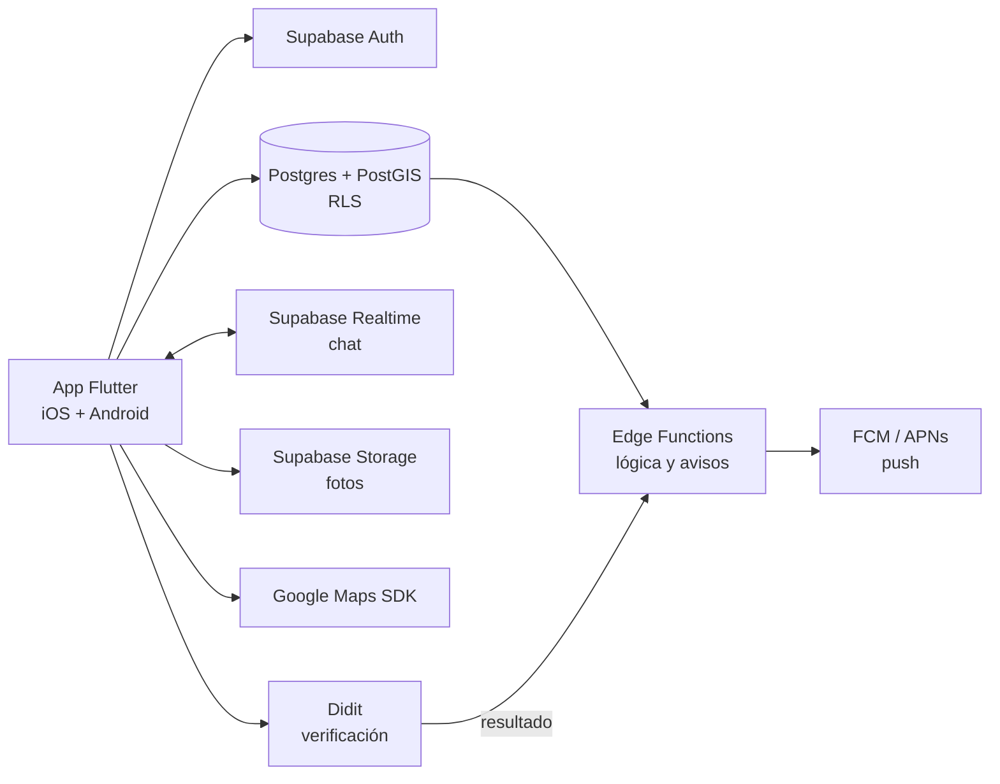

# Pacer Match — Documento de visión

## 1. En una línea
Pacer Match conecta corredores que buscan compañía para una sesión concreta —mismo ritmo, distancia, hora y zona— y lo hace de forma segura: identidad verificada y punto de encuentro protegido hasta que hay match. Proponemos un MVP con infraestructura de costo casi cero (Flutter + Supabase) para mostrar tracción a inversionistas, construido sobre la misma base que usará el producto, para no tirarlo después.

## 2. Problema y oportunidad
- **Problema (spec del PO):** corredores que no encuentran compañeros de su mismo ritmo o distancia dentro de su club o zona.
- **La categoría existe.** Strava reporta 195 millones de atletas y en julio de 2026 sumó una pestaña de eventos con carreras grupales. Ya hay apps que emparejan por ritmo: Movemates, Run with me (ritmo verificado) y RunPal (opción solo mujeres).
- **Hueco a validar:** sesiones puntuales por ritmo (no comunidades), con la confianza como estándar y foco en Latinoamérica. El diferencial final lo decide el PO (D-PO3).

## 3. Usuarios
| Perfil | Qué necesita | Qué le da Pacer Match |
|---|---|---|
| Corredor independiente | Compañía de su ritmo para una sesión concreta | Feed por radio, ritmo, fecha y distancia; solicitud con mensaje |
| Corredor de club | Entrenar fuera del horario o del ritmo de su club | Sesiones puntuales con gente de su zona |
| Visitante | Ver si hay movimiento antes de registrarse | Feed restringido (zona y ritmo) |
| Entrenador o club (producto) | Llenar sesiones y gestionar grupo | Plan B2B, si el PO elige ese modelo (§8) |

## 4. Objetivos
**General.** Ofrecer una app móvil donde un corredor publique o encuentre, en minutos, un entrenamiento con personas de ritmo compatible cerca de él, y se reúna con ellas con garantías de seguridad.

**Específicos (producto):**
1. Publicar entrenamientos con tipo, distancia, ritmo objetivo, fecha y punto de encuentro, mostrando solo una zona aproximada antes del match.
2. Descubrir entrenamientos por radio en km, rango de ritmo, fecha y distancia.
3. Gestionar el ciclo completo de la solicitud: enviar con mensaje, aceptar, rechazar, cancelar y expirar.
4. Coordinar tras el match con chat en tiempo real y notificaciones push.
5. Sostener la confianza: identidad verificada, reportar y bloquear, borrado de cuenta y datos mínimos.
6. Validar el ritmo con actividades importadas de Apple Salud, Health Connect o Garmin.
7. Habilitar el modelo de ingresos que elija el PO.
8. Cumplir los requisitos de App Store, Google Play y la ley de datos del mercado de lanzamiento.

**Del MVP:** una app instalable en iOS y Android que recorra el flujo completo (registro → publicar o buscar → solicitud → match → chat) y mida las métricas del §11, para la ronda con inversionistas.

## 5. Alcance: MVP y producto
| Capacidad | MVP | Producto v1 | Después |
|---|---|---|---|
| Registro con correo + perfil de corredor (foto, ritmo, ciudad, 18+) | ✓ | ✓ | |
| Login con Apple y Google | Recortable | ✓ | |
| Verificación de identidad (documento + selfie) | ✓ si el PO lo confirma (D-PO4) | ✓ | |
| Crear entrenamiento con pin en el mapa; zona aproximada antes del match | ✓ | ✓ | |
| Feed con filtros de radio, ritmo y fecha | ✓ | ✓ | |
| Filtro por distancia y marcas 10k/21k/42k | Recortable | ✓ | |
| Modo visitante | Recortable (D-PO5) | ✓ | |
| Solicitud con mensaje, aceptar/rechazar, cancelar, expirar | ✓ | ✓ | |
| Chat 1:1 en tiempo real + notificaciones push | ✓ | ✓ | |
| Entrenamientos grupales y chat de grupo | — | Según D-PO2 | |
| Reportar, bloquear y borrar cuenta (lo exigen las tiendas) | ✓ | ✓ | |
| Moderación de reportes | Desde el panel de Supabase | Panel de administración | |
| Valoraciones y reputación | — | ✓ | |
| Ritmo verificado con actividades importadas | — | ✓ | |
| Compartir el plan con un contacto de confianza | — | ✓ | |
| Cobros (suscripción o plan para clubes) | — | ✓ (§8) | |
| Versión web | — | Landing | App web |
| Registro propio de recorrido y pasos (GPS) | — | — | Solo si los datos lo piden |

**Fuera de alcance, por ahora:**
- **Tracking GPS propio.** Es el bloque más caro y el más revisado por las tiendas (ubicación en segundo plano), y compite de frente con Strava y Garmin. En su lugar se importan actividades.
- **Web en el MVP.** Un solo código móvil para iOS y Android.
- **Pagos en el MVP.** Primero se valida el uso; el modelo se presenta como hipótesis.

## 6. Requisitos no funcionales
| Área | Requisito |
|---|---|
| Seguridad física | El punto exacto solo se ve tras el match. La ubicación del usuario nunca se muestra; solo el punto que él elige. |
| Identidad | Verificación por un proveedor externo. Guardamos solo el resultado y el ID de la verificación, no la cédula ni la biometría. |
| Privacidad | Política de privacidad y términos publicados, consentimiento explícito para datos sensibles, borrado de cuenta en la app y por enlace web, retención mínima. Validar con un abogado según el país. |
| Permisos | Ubicación y notificaciones se piden en contexto, con el texto que exige Apple. |
| Plataformas | iOS y Android con el mismo código y la misma interfaz. |
| Disponibilidad | MVP: planes gratuitos, sin garantía de servicio. Producto: planes de pago con respaldo. |
| Observabilidad | Reporte de errores desde la primera versión y eventos propios para las métricas del §11. |
| Idioma | Español. Unidades: según el mercado (D-PO1). |

## 7. Arquitectura propuesta

| Capa | MVP (decidido) | Costo MVP | Producto |
|---|---|---|---|
| App | Flutter, un código para iOS y Android | US$0 | Igual |
| Backend | Supabase Free: Postgres + PostGIS, Auth, Storage, Realtime, Edge Functions | US$0 | Supabase Pro, desde US$25/mes |
| Mapas | Google Maps SDK sin estilos en la nube (map ID) | US$0 | Igual; búsqueda de lugares y geocodificación se pagan al pasar el cupo gratis |
| Push | Firebase Cloud Messaging (también entrega en iOS) | US$0 | Igual |
| Verificación | Didit | 500 gratis/mes; luego ≈ US$0,30 c/u | Igual u otro proveedor según el país |
| Errores | Firebase Crashlytics | US$0 | Igual |
| Tiendas | TestFlight + prueba interna de Google Play | US$99/año Apple + US$25 único Google | Publicación pública |

**Por qué este stack.** La búsqueda por radio y las rutas son consultas geográficas nativas en PostGIS. El chat sale de Realtime. Las fotos y la lógica de servidor entran en el plan gratis. El ciclo de solicitudes es relacional y se protege con reglas por fila (RLS). Flutter pinta su propia interfaz, así que se ve igual en iOS y Android.

**Ruta de crecimiento.** Supabase es Postgres estándar. Cuando el volumen, el costo o un cliente lo pidan, se migra por piezas a AWS sin reescribir la app de golpe: base de datos a RDS/Aurora, funciones a Lambda, archivos a S3.

**Límites del plan gratis que hay que vigilar:** 500 MB de base de datos, 50.000 usuarios activos al mes, 200 conexiones simultáneas de chat y pausa del proyecto tras 1 semana sin actividad. Contra la pausa: un ping programado, o pasar a Pro durante la ronda de demos.

**Costo de verificación al crecer:** (verificaciones del mes − 500) × ≈ US$0,30. Por eso se pide solo para crear o solicitar, no para explorar.

## 8. Modelo de negocio (hipótesis — decide el PO, D-PO6)
| Modelo | Referencia del mercado | Encaje en Pacer Match |
|---|---|---|
| Suscripción freemium | Strava: US$79,99/año | Filtros avanzados, entrenamientos ilimitados, ver quién se interesó |
| Plan para clubes y entrenadores | Meetup cobra a organizadores desde US$29,99/mes | Perfil verificado, sesiones destacadas, gestión de grupo |
| Comisión por sesión paga | Plataformas de clubes: 1–5% por transacción | Sesiones con entrenador |
| Patrocinios y alianzas | Retos patrocinados en Strava | Carreras y retos de marcas, tiendas de running |

Propuesta: freemium como modelo principal y plan B2B para clubes como respaldo. Las suscripciones dentro de la app pagan comisión a Apple y Google.

## 9. Limitaciones y supuestos
- Un solo desarrollador. El plazo y el presupuesto van en un documento aparte.
- El MVP usa planes gratuitos, con los límites del §7.
- El ritmo es autodeclarado en el MVP.
- Interfaz con un kit de componentes estándar, salvo que el PO aporte diseño (D-PO8).
- Entrenamientos 1:1 hasta que el PO defina lo grupal (D-PO2).
- Mercado de lanzamiento sin definir. De él dependen el idioma, las unidades, la cobertura de la verificación y la ley de datos (D-PO1).
- **Legal:** la biometría es dato sensible. En Colombia (Ley 1581/2012 y Decreto 1377/2013, art. 6) no se puede condicionar el servicio a entregarla. Venezuela no tiene ley integral de datos. Hace falta revisión de un abogado antes del lanzamiento público.
- **Nombre:** ya existe "Pacer" (Pacer Health), app de caminar y correr con más de 10 millones de descargas en Android. Hay que revisar marcas antes de invertir en identidad visual.

## 10. Riesgos
| Riesgo | Impacto | Mitigación |
|---|---|---|
| Un incidente en un encuentro | Alto: confianza y reputación | Verificación, zona aproximada, reportar y bloquear; en el producto, compartir el plan |
| Feed vacío al lanzar | Alto: nadie vuelve | Lanzar por ciudad, sembrar con clubes aliados, datos de demo |
| Strava suma emparejamiento por ritmo | Medio | Diferencial claro (D-PO3) y velocidad |
| Costo de verificación al escalar | Medio | Solo para crear o solicitar; cupo gratis |
| El proyecto gratis se pausa en plena demo | Medio | Ping programado o Pro durante la ronda |
| Rechazo en tiendas | Medio | Cumplir desde el MVP: borrado de cuenta, reportes, privacidad, permisos |
| Conflicto de marca con "Pacer" | Medio | Búsqueda de marcas antes del branding |
| Depender de una sola persona | Medio | Decisiones y diseño documentados en el repo (ADR y vault) |

## 11. Métricas de éxito
Para el MVP, con metas a fijar con el PO:
- Entrenamientos creados por semana.
- Porcentaje de solicitudes aceptadas.
- Porcentaje de entrenamientos con match confirmado.
- Retención a 4 semanas.
- Porcentaje de usuarios con identidad verificada.

## 12. Decisiones abiertas para el PO
Las preguntas están comentadas en el spec del PO.

| # | Decisión | Propuesta |
|---|---|---|
| D-PO1 | Mercado de lanzamiento (país y ciudad) | — |
| D-PO2 | Entrenamientos 1:1 o grupales | 1:1 en el MVP |
| D-PO3 | Diferencial frente a la competencia | Confianza + sesiones puntuales + LatAm |
| D-PO4 | Verificación: obligatoria para quién, y si entra en el MVP | Para crear y solicitar, en el MVP |
| D-PO5 | Modo visitante en el MVP | Recortable |
| D-PO6 | Modelo de ingresos | Freemium + plan para clubes |
| D-PO7 | ¿El MVP se publica en tiendas o se reparte a testers? ¿Cuentas a nombre de la empresa? | Testers (TestFlight y prueba interna) |
| D-PO8 | Diseño: ¿hay diseñador o Figma? | Kit estándar |
| D-PO9 | Fecha objetivo para la ronda | — |
| D-PO10 | Nombre y marca | Revisar marcas |
| D-PO11 | Login social en el MVP | Correo + Apple + Google si cabe |

## Fuentes (consultadas el 18-10-2026)
- Supabase, precios: https://supabase.com/pricing
- Firebase, precios y cambio de Storage: https://firebase.google.com/pricing · https://firebase.google.com/docs/storage/faqs-storage-changes-announced-sept-2024
- Google Maps Platform, precios: https://developers.google.com/maps/billing-and-pricing/pricing
- Didit, precios y cobertura: https://docs.didit.me/getting-started/pricing · https://didit.me/solutions/countries/venezuela/ · https://didit.me/solutions/countries/colombia/
- Apple, membresías y guías de revisión: https://developer.apple.com/support/compare-memberships/ · https://developer.apple.com/app-store/review/guidelines/
- Google Play, registro y prueba cerrada: https://support.google.com/googleplay/android-developer/answer/6112435 · https://support.google.com/googleplay/android-developer/answer/14151465
- Strava, cifras y precio: https://press.strava.com/ · https://www.strava.com/subscribe
- Strava, pestaña de eventos: https://9to5mac.com/2026/07/09/strava-gets-an-events-tab-with-upcoming-races-group-runs-more/
- Meetup, planes: https://help.meetup.com/hc/en-us/articles/28677808413197
- Heylo, tarifas: https://heylo.com/help/platform-and-processing-fees
- Competidores: https://apps.apple.com/us/app/movemates-move-together/id6748308903 · https://apps.apple.com/app/id6762994283 · https://apps.apple.com/app/id6746698548
- Pacer Health: https://play.google.com/store/apps/details?id=cc.pacer.androidapp
- Ley 1581/2012: https://www.saludcapital.gov.co/Normo/gsp/ley_1581_de_2012.pdf · Decreto 1377/2013: https://normas.cra.gov.co/gestor/docs/decreto_1377_2013.htm
